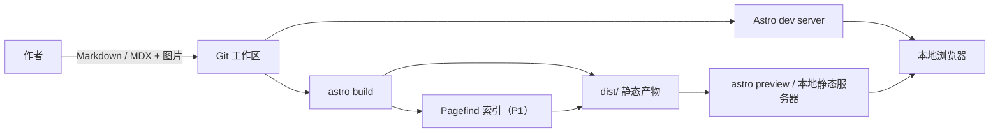
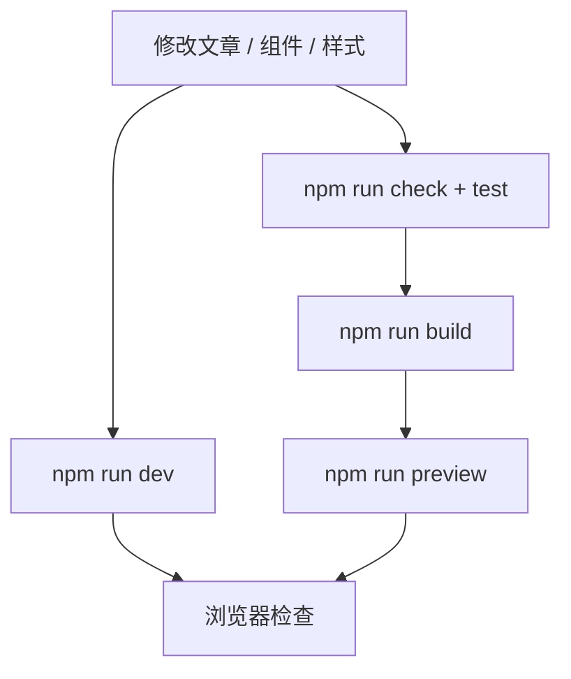

# 个人博客 · 原型架构

**状态：** 原型设计 v2（部署不在范围）  
**日期：** 2026-10-18  
**范围：** 先做出本地可运行、可交互的静态博客原型，验证内容模型、视觉系统与核心阅读路径。部署、域名、CI/CD、评论、分析均推迟。  
**关联：** [原型实施计划](./prototype-plan.md) · [视觉与交互设计](./design.md) · [设计系统](../design-system/deskbox-blog/MASTER.md) · [ADR](./adr/)

---

## 1. 目标与非目标

### 1.1 目标

1. **写作零摩擦**：文章是 Git 工作区里的 Markdown/MDX，不依赖 CMS、数据库或后台。
2. **本地静态优先**：`npm run dev` 可浏览，`npm run build` 产出纯静态 `dist/`；无服务器、无数据库。
3. **长期可维护**：内容结构有类型约束；依赖面小；目录与命名稳定；纯文本内容可迁移。
4. **阅读体验**：中文排版、暗色模式、目录、标签、归档、全文搜索（P1）、RSS（P1）。
5. **可访问性**：原型阶段完成键盘、焦点、对比度、响应式等基础检查；WCAG 2.2 AA 为目标。
6. **可迁移**：构建产物是纯静态文件；部署平台不在本轮决策，但保持未来可迁移。

### 1.2 非目标（原型阶段）

- 部署、域名、CDN、HTTPS、headers、备案、回滚。
- CI/CD、Lighthouse 门禁、预览部署。
- 评论、分析、邮件订阅、支付、电商。
- 用户账号、登录、权限、多作者协作。
- 数据库、服务端 API、SSR。
- 可视化 CMS / 页面搭建器。
- 多语言路由（原型中文为主；schema 预留 `lang`）。
- 重型客户端框架 / SPA 路由。
- 真实作者资料与正式内容（原型使用示例内容）。

> 这些能力若未来需要，应在原型验收后单独评估，而不是在原型上叠加。

### 1.3 原型范围

**P0 — 可看的原型**

- Astro 7 项目、TypeScript strict、内容集合。
- 设计 token、全局样式、正文排版。
- 首页、文章列表、文章页、About、404。
- 3 篇丰富示例文章 + 9 篇短文（用于列表/分页压力测试）。
- Header/Footer、主题切换、移动导航、跳过链接。
- 文章页 TOC、代码复制、上一篇/下一篇。
- 响应式：375 / 768 / 1024 / 1440。
- `styleguide` 参考页（`noindex`，不进入导航）用于检查 token 与组件。

**P1 — 能读的原型**

- `/tags/`、`/tags/[tag]/`、`/archive/`。
- 分页（12 篇示例内容即可验证第 2 页）。
- Pagefind 搜索页（中文关键词验收）。
- RSS、sitemap、robots、SEO 组件。
- 自托管 Latin 字体子集评估（Public Sans / Libre Bodoni；收益明显才接入）。
- Playwright 烟测扩展（搜索/RSS）与 axe 复查。

**不在原型内**

- 部署与托管、评论、分析、OG 图生成、多语言、定时发布。

**原型验收**

- `npm run dev` 可访问所有路由；`npm run build` 成功产出 `dist/`。
- 375px 无横向滚动；Light/Dark/系统三种状态正确。
- 示例文章覆盖长标题、宽代码块、宽表格、图片、脚注、无标签/无封面等情况。
- 无第三方请求；无 emoji 图标；键盘可完成主要路径。
- 具体任务见 [原型实施计划](./prototype-plan.md)。

---

## 2. 核心决策摘要

| 领域 | 决策 | 理由 |
|---|---|---|
| 站点形态 | 构建期静态站点（SSG） | 内容更新频率低；原型本地运行；无运维 |
| 框架 | Astro 7.x + TypeScript strict | 内容集合类型安全；默认零 JS；Markdown/MDX 原生 |
| 内容源 | Git 工作区中的 Markdown/MDX | 版本化、可审查、可迁移、无 CMS 依赖 |
| 内容校验 | Astro Content Collections + Zod | 构建期失败，避免坏数据进入原型 |
| 样式 | 原生 CSS + 设计 token，无 Tailwind | 设计系统固定、组件少；减少构建依赖与类名噪音 |
| 搜索 | Pagefind 1.5+（P1） | 构建期索引、运行时无服务；1.5+ 支持 CJK 自动分词 |
| 订阅 | RSS 2.0（全文，P1） | 个人博客的标准分发方式；原型后期验证 |
| 图片 | `astro:assets` + Sharp | 构建期生成 AVIF/WebP、尺寸与占位 |
| 部署 | **本轮不决策** | 只保证 `npm run dev` 与纯静态 `dist/`；上线另行评估 |
| 测试 | Vitest + Playwright + axe（基础烟测） | 验证路由、主题、响应式与可访问性；Lighthouse 手工检查 |
| 评论 / 分析 | **原型不做** | 避免第三方依赖与部署配置，先验证阅读体验 |
| 运行时 JS | 主题、代码复制、TOC 高亮；搜索页 P1 按需加载 | 初始 JS < 4KB gzip |

**版本基线（2026-10-18 核对）：** Node `>=22.22.0`；Astro `7.4.x`；`@astrojs/mdx` `8.1.x`；`@astrojs/sitemap` `3.7.x`；`@astrojs/rss` `4.0.x`；Pagefind `1.5.2`。用 lockfile 固定实际版本。

---

## 3. 系统上下文



**边界**

- 构建期：内容读取、Zod 校验、Markdown 渲染、图片优化、RSS/sitemap（P1）、Pagefind 索引（P1）。
- 运行期：本地浏览器；脚本只负责主题切换、代码复制、TOC 高亮、搜索页（P1）。
- 第三方：原型零第三方请求；评论、分析、外部字体 CDN 均不引入。
- 部署：不在本轮链路中；`dist/` 只用于本地 preview。

---

## 4. 本地开发与构建流水线



### 4.1 本地命令

```bash
npm run dev        # astro dev，开发时主要入口
npm run check      # astro check + tsc --noEmit
npm run test       # vitest run
npm run build      # astro build；P1 追加 pagefind --site dist
npm run preview    # astro preview（构建后本地预览）
npm run test:e2e   # playwright test
```

### 4.2 原型门禁（本地）

| 阶段 | 检查 | 要求 |
|---|---|---|
| 静态检查 | `astro check`、TypeScript strict | 必须通过 |
| 单元测试 | 内容排序/过滤、标签注册表、slug 唯一、阅读时间、日期格式 | 必须通过 |
| 构建 | `npm run build` | 必须成功，产出 `dist/` |
| E2E | 路由、导航、主题、目录、404、移动端溢出 | 必须通过 |
| 可访问性 | axe：无 serious/critical | 必须通过 |
| 性能 | Lighthouse 手工跑一次 | 记录结果，不作为原型门禁 |

> 原型不做 CI/CD；以上命令在本地执行。Lighthouse CI、部署预览与自动回滚推迟到上线阶段。

### 4.3 部署（不在本轮）

- 原型只要求本地 `npm run dev` 与 `npm run build`。
- 部署平台、域名、CDN、HTTPS、headers、备案、备份、回滚均推迟到原型验收后。
- 不在原型中引入部署专用配置（`_headers`、`_redirects`、环境变量）。
- 保持 `dist/` 纯静态，确保未来可迁移；但本轮不选择平台。

---

## 5. 技术栈

| 层 | 选型 | 说明 |
|---|---|---|
| 语言 | TypeScript strict | 内容 schema、工具函数、组件 props |
| 框架 | Astro 7.x | 静态输出；岛屿架构；Markdown/MDX |
| 内容 | Astro Content Collections + Zod | `src/content.config.ts`；`glob` loader |
| 渲染 | Markdown/MDX + Shiki | 构建期语法高亮；无运行时高亮 |
| 样式 | CSS custom properties + Astro scoped styles | token 见设计系统；无 CSS 框架 |
| 图片 | `astro:assets` + Sharp | 响应式宽度、AVIF/WebP、显式尺寸 |
| 搜索 | Pagefind 1.5+（P1） | 构建后索引；CJK 自动分词 |
| 评论 | 原型不做 | 上线前再评估 Giscus |
| Feed | `@astrojs/rss`（P1） | RSS 2.0，全文 |
| Sitemap | `@astrojs/sitemap`（P1） | 自动生成；过滤 search/404 |
| 测试 | Vitest / Playwright / axe-core | 单元 / E2E / 可访问性；Lighthouse 手工检查 |
| 托管 | 原型不选型 | 本地 dev/preview；`dist/` 可迁移，上线另议 |

### 5.1 为什么不是其他方案

| 方案 | 不选原因 |
|---|---|
| Next.js App Router | 需要 SSR/服务端能力时才有优势；个人博客引入 Node 运行时、缓存与部署复杂度 |
| Hugo | 构建快，但模板类型安全与 JS 生态弱；内容校验不如 Zod 直接 |
| 纯手写 HTML | 路由、RSS、sitemap、分页、图片优化都要手写，长期维护成本高 |
| WordPress / 数据库 CMS | 需要服务器、数据库、插件与安全维护；与“Git 即内容”冲突 |
| Tailwind CSS | 组件数量少且设计 token 固定；原生 CSS 更直接、构建更少 |

---

## 6. 内容模型

### 6.1 目录约定

```text
src/content/blog/
└── 2026/
    └── 10/
        └── hello-world/
            ├── index.mdx        # 正文
            ├── cover.jpg        # 可选封面
            └── diagram.png      # 正文图片（MDX 中 <Image /> 引用）
```

- 文章以目录为单位，图片与文章同目录，便于迁移与相对引用。
- `slug` 在 frontmatter 中显式声明，与 URL 一致；目录名可自由组织。
- 文件名固定为 `index.md` 或 `index.mdx`；loader pattern：`**/index.{md,mdx}`。

### 6.2 Frontmatter schema

```ts
// src/content.config.ts
import { defineCollection } from 'astro:content';
import { glob } from 'astro/loaders';
import { z } from 'astro/zod';
import { tagNames } from './data/tags';

const blog = defineCollection({
  loader: glob({
    base: './src/content/blog',
    pattern: '**/index.{md,mdx}',
  }),
  schema: ({ image }) =>
    z.object({
      title: z.string().min(1).max(80),
      description: z.string().min(20).max(160),
      slug: z.string().regex(/^[a-z0-9]+(?:-[a-z0-9]+)*$/),
      pubDate: z.coerce.date(),
      updatedDate: z.coerce.date().optional(),
      tags: z.array(z.enum(tagNames)).max(3).default([]),
      draft: z.boolean().default(false),
      lang: z.enum(['zh-CN', 'en']).default('zh-CN'),
      cover: image().optional(),
      coverAlt: z.string().min(1).optional(),
      canonical: z.string().url().optional(),
      series: z
        .object({
          name: z.string().min(1),
          order: z.number().int().positive(),
        })
        .optional(),
    })
    .superRefine((data, ctx) => {
      if (data.cover && !data.coverAlt) {
        ctx.addIssue({
          code: 'custom',
          path: ['coverAlt'],
          message: 'coverAlt is required when cover is set',
        });
      }
      if (data.updatedDate && data.updatedDate < data.pubDate) {
        ctx.addIssue({
          code: 'custom',
          path: ['updatedDate'],
          message: 'updatedDate must be >= pubDate',
        });
      }
    }),
});

export const collections = { blog };
```

### 6.3 字段说明

| 字段 | 必填 | 规则 | 用途 |
|---|---|---|---|
| `title` | 是 | 1–80 字符；中文建议 ≤ 40 | 标题、SEO、RSS |
| `description` | 是 | 20–160 字符 | 列表摘要、meta description、OG |
| `slug` | 是 | 小写 ASCII、kebab-case、全局唯一 | URL `/blog/<slug>/` |
| `pubDate` | 是 | ISO 日期；按站点时区过滤未来日期 | 排序、RSS、JSON-LD |
| `updatedDate` | 否 | ≥ `pubDate` | 显示“更新于”、`dateModified` |
| `tags` | 否 | 最多 3 个；必须存在于注册表 | 标签页、筛选 |
| `draft` | 否 | 默认 `false`；构建时排除 | 草稿 |
| `lang` | 否 | `zh-CN` / `en`，默认 `zh-CN` | `<html lang>`、RSS |
| `cover` | 否 | 构建期图片优化 | 列表/文章/OG |
| `coverAlt` | 条件 | 有 `cover` 时必填 | 可访问性 |
| `canonical` | 否 | 绝对 URL | 跨站转载时指向原文 |
| `series` | 否 | `{ name, order }` | 系列文章导航 |

### 6.4 标签注册表

标签不是自由字符串，而是集中维护的注册表：

```ts
// src/data/tags.ts
export const tags = [
  { name: '前端', slug: 'frontend', description: '浏览器、框架与工程化' },
  { name: '后端', slug: 'backend', description: '服务端、数据与基础设施' },
  { name: '工程实践', slug: 'engineering', description: '协作、测试与交付' },
  { name: '阅读', slug: 'reading', description: '书与长文笔记' },
  { name: '生活', slug: 'life', description: '写作之外' },
] as const;

type TagName = (typeof tags)[number]['name'];
export const tagNames = tags.map((t) => t.name) as [TagName, ...TagName[]];

export function tagBySlug(slug: string) {
  return tags.find((t) => t.slug === slug);
}
```

**理由**

- 避免同义标签（`前端` / `frontend` / `Frontend`）分裂内容。
- URL 使用 ASCII slug，中文标签显示为中文，链接稳定可分享。
- 构建期 `z.enum(tagNames)` 直接拒绝未注册标签；新增标签只需改一个文件。

### 6.5 发布过滤

日期按站点时区（`Asia/Shanghai`）的**日历日**比较，避免 `YYYY-MM-DD` 被解析为 UTC 午夜后，当天 08:00（北京时间）之前被误判为“未来”：

```ts
// src/data/site.ts
export const SITE_TIME_ZONE = 'Asia/Shanghai';

// src/lib/posts.ts
const dayFormat = new Intl.DateTimeFormat('en-CA', {
  timeZone: SITE_TIME_ZONE,
});

export function isPublished(
  post: CollectionEntry<'blog'>,
  opts: { includeDrafts?: boolean; now?: Date } = {},
) {
  const { draft, pubDate } = post.data;
  if (draft && !opts.includeDrafts) return false;

  const pubDay = dayFormat.format(pubDate); // YYYY-MM-DD
  const nowDay = dayFormat.format(opts.now ?? new Date());
  return pubDay <= nowDay;
}
```

- 构建：排除 `draft` 与未来日期（按站点时区）。
- 本地开发：可显示草稿（`import.meta.env.DEV`）；原型不涉及预览部署。
- 需要精确到时刻的定时发布，frontmatter 使用带时区的 ISO 时间（如 `2026-10-18T09:00:00+08:00`）。
- `slug` 唯一性、标签存在性、封面 alt 在构建/单测中校验。

---

## 7. 路由与渲染

`astro.config.mjs` 关键项：

```js
export default defineConfig({
  site: 'http://localhost:4321', // 原型占位；上线时替换
  trailingSlash: 'always',
  build: { format: 'directory' },
  integrations: [mdx()], // P1（Task 12）再追加 sitemap()
  markdown: {
    remarkPlugins: [remarkGfm],
    shikiConfig: {
      themes: { light: 'github-light', dark: 'github-dark' },
      defaultColor: false,
      wrap: true,
    },
  },
});
```

| 阶段 | 路径 | 源文件 | 渲染 | 说明 |
|---|---|---|---|---|
| P0 | `/` | `src/pages/index.astro` | 静态 | 首页：简介 + 最新 + 最近文章 |
| P0 | `/blog/` | `src/pages/blog/index.astro` | 静态 | 第 1 页，每页 10 篇 |
| P0 | `/blog/[slug]/` | `src/pages/blog/[slug].astro` | 静态 | 文章详情 |
| P0 | `/about/` | `src/pages/about.astro` | 静态 | 关于 |
| P0 | `/404.html` | `src/pages/404.astro` | 静态 | 404 |
| P1 | `/blog/page/[page]/` | `src/pages/blog/page/[page].astro` | 静态 | 第 2..N 页 |
| P1 | `/tags/` | `src/pages/tags/index.astro` | 静态 | 标签索引 |
| P1 | `/tags/[tag]/` | `src/pages/tags/[tag].astro` | 静态 | 标签文章列表（不分页） |
| P1 | `/archive/` | `src/pages/archive.astro` | 静态 | 按年归档 |
| P1 | `/search/` | `src/pages/search.astro` | 静态壳 | 客户端 Pagefind |
| P1 | `/rss.xml` | `src/pages/rss.xml.ts` | 静态 | RSS 2.0 |
| P1 | `/sitemap-index.xml` | `@astrojs/sitemap` | 静态 | 站点地图 |
| P1 | `/robots.txt` | `src/pages/robots.txt.ts` | 静态 | 指向 sitemap |

**约定**

- 所有公开 URL 以 `/` 结尾；canonical、RSS、内部链接统一使用尾斜杠。
- `/blog/page/2/` 与 `/blog/[slug]/` 不冲突：Astro 静态段优先于动态段。
- 第 1 页固定在 `/blog/`，分页组件对第 1 页输出 `/blog/`，不生成 `/blog/page/1/`。
- 搜索页 `noindex`，且从 sitemap 排除；404 同样排除。
- 草稿与未来文章不进入任何列表、RSS、sitemap 或 Pagefind 索引。

---

## 8. 目录结构

```text
blog/
├── astro.config.mjs
├── package.json
├── tsconfig.json
├── playwright.config.ts
├── public/
│   ├── favicon.svg
│   ├── fonts/                  # P1：Public Sans / Libre Bodoni Latin 子集
│   └── scripts/theme-init.js   # 阻塞式，防主题闪烁
├── src/
│   ├── content.config.ts
│   ├── content/blog/           # 文章目录（index.md / index.mdx）
│   ├── data/
│   │   ├── site.ts             # 站点名、作者、社交链接、导航
│   │   └── tags.ts             # 标签注册表
│   ├── layouts/
│   │   ├── BaseLayout.astro
│   │   └── PostLayout.astro
│   ├── components/
│   │   ├── SiteHeader.astro
│   │   ├── SiteFooter.astro
│   │   ├── Seo.astro           # P1
│   │   ├── PostCard.astro
│   │   ├── PostList.astro
│   │   ├── TagList.astro       # P1
│   │   ├── Pagination.astro    # P1
│   │   ├── TableOfContents.astro
│   │   ├── PrevNext.astro
│   │   ├── ThemeToggle.astro
│   │   └── Icon.astro
│   ├── lib/
│   │   ├── posts.ts            # 查询、排序、过滤、slug 唯一性
│   │   ├── format.ts           # 按 Asia/Shanghai 格式化日期
│   │   ├── reading-time.ts     # 中英文阅读时间
│   │   ├── seo.ts              # canonical / JSON-LD 数据
│   │   └── urls.ts             # 绝对 URL、尾斜杠
│   ├── styles/
│   │   ├── tokens.css
│   │   ├── global.css
│   │   ├── prose.css
│   │   └── fonts.css           # P1
│   ├── scripts/
│   │   ├── code-copy.ts
│   │   └── toc-highlight.ts
│   ├── pages/
│   │   ├── index.astro
│   │   ├── about.astro
│   │   ├── 404.astro
│   │   ├── styleguide.astro    # noindex 参考页
│   │   └── blog/
│   └── env.d.ts
├── tests/
│   ├── unit/
│   └── e2e/
├── docs/
└── design-system/
```

**边界规则**

- `components/` 只做展示与局部交互；内容查询在 `lib/posts.ts`。
- `data/` 是站点级配置与注册表；不写业务逻辑。
- `lib/` 是纯函数，可在 Vitest 中直接测试。
- `pages/` 只负责取数、路由与组合；不直接写复杂格式化逻辑。
- `styles/prose.css` 是全局样式（Markdown 内容不在 Astro scoped 范围内）。

---

## 9. 运行时与 JavaScript 预算

| 脚本 | 加载时机 | 预算（gzip） |
|---|---|---:|
| `theme-init.js` | `<head>` 阻塞，防闪烁 | < 0.5KB |
| 主题切换 | 全站，`defer` | < 1KB |
| 代码复制 | 文章页，事件委托 | < 1KB |
| TOC 当前项高亮 | 文章页，IntersectionObserver，渐进增强 | < 1KB |
| Pagefind UI | 仅 `/search/`（P1） | 按需，页面级 |
| 评论 / 分析 | 原型不加载 | 0 |

**规则**

- 默认零客户端框架；不引入 React/Vue/Svelte 运行时，除非某个交互确实需要岛屿。
- 不使用 `client:load` 包裹整页；岛屿只包裹单个交互组件。
- 原型不加载任何第三方脚本或外部字体 CDN。
- 所有脚本使用 `defer`，主题初始化除外（必须阻塞以避免 FOUC）。
- 不写内联脚本；主题初始化放在 `public/scripts/theme-init.js`，便于后续配置 CSP。

---

## 10. 搜索（P1）

> P0 不做搜索：导航暂不显示搜索入口。P1 完成标签/归档后再加回搜索。

- **索引时机**：`astro build` 之后运行 `pagefind --site dist`，索引构建后的 HTML。
- **索引范围**：`<article data-pagefind-body>`；导航、页脚加 `data-pagefind-ignore`。
- **CJK**：Pagefind 1.5+ 内置自动 CJK 分词；用原型示例文章验收（见 §15）。
- **UI**：仅 `/search/` 加载 `pagefind-ui.js` / `pagefind-ui.css`；首页/文章页不加载。
- **URL**：`/search/?q=关键词` 可分享；输入同步 query string。
- **无 JS**：`<noscript>` 提示并链接到 `/archive/`。
- **样式**：通过 Pagefind UI CSS 变量映射到设计 token（见设计系统 §7）。
- **索引排除**：`/search/`、`/404`、草稿、未来文章、分页页（可选）。
- **预算**：搜索页额外 JS/CSS 不计入全站首屏预算；P1 手工记录体积。
- **开发模式**：Pagefind 索引只在 `build` 后存在；`astro dev` 中搜索页显示“索引未加载”，完整验收用 `npm run build && npm run preview`。

---

## 11. SEO · Feed · Sitemap（P1）

### 11.1 每页输出

- `<title>`：`页面标题 · 站点名`；首页使用站点名 + 一句话定位。
- `<meta name="description">`：文章用 `description`；列表页用站点描述。
- `<link rel="canonical">`：`new URL(Astro.url.pathname, Astro.site)`，统一尾斜杠。
- Open Graph：`og:type`、`og:title`、`og:description`、`og:url`、`og:image`、`og:locale=zh_CN`。
- Twitter Card：`summary_large_image`（有封面）或 `summary`。
- `<html lang="zh-CN">`；英文文章可覆盖为 `en`。
- RSS autodiscovery：`<link rel="alternate" type="application/rss+xml" href="/rss.xml">`。
- 文章 JSON-LD：`BlogPosting`（`headline`、`description`、`datePublished`、`dateModified`、`author`、`image`、`mainEntityOfPage`、`keywords`）。
- 首页 JSON-LD：`WebSite` + `Person`。
- 404 / 搜索页：`noindex, follow`（或 `noindex, nofollow`）。

### 11.2 RSS

- RSS 2.0，全文输出；相对链接在生成时转为绝对 URL。
- `pubDate` 使用文章日期；`lastBuildDate` 使用构建时间。
- 只包含已发布文章；按 `pubDate` 降序。
- Feed 中代码块保留 `<pre><code>`；图片使用绝对 URL。
- 文章更新不重发条目（保持稳定 `guid`：`/blog/<slug>/`）。

### 11.3 Sitemap / robots

- `@astrojs/sitemap` 生成 `sitemap-index.xml`；过滤 `/search/`、`/404`、`/styleguide/`、分页页。
- `robots.txt`：

```text
User-agent: *
Allow: /
Disallow: /search/

Sitemap: http://localhost:4321/sitemap-index.xml
```

- 上面的 sitemap URL 是原型占位；上线时替换为正式域名。
- 不在 sitemap 中的页面必须有明确理由（搜索页、404）。
- 原型只保证站内链接正确；旧 URL 的 301 与域名迁移在上线阶段处理。

---

## 12. 可访问性

目标：**WCAG 2.2 AA**。

- 语义结构：`header` / `nav` / `main` / `article` / `footer`；每页一个 `h1`。
- 跳过链接：首个可聚焦元素，指向 `#main`。
- 键盘：导航、主题切换、目录、分页、搜索（P1）全部可达；焦点顺序与视觉顺序一致。
- 焦点：`outline: 2px solid var(--focus); outline-offset: 2px`；禁止无替代地 `outline: none`。
- 对比度：见设计系统 §2.2；正文 ≥ 4.5:1，控件边界 ≥ 3:1。
- 触控目标：≥ 44×44px；相邻目标间距 ≥ 8px。
- 图片：内容图必须有 `alt`；装饰图 `alt=""`；封面缺 `coverAlt` 构建失败。
- 语言：`<html lang>` 正确；英文片段/代码使用 `lang="en"` 时可加。
- 动效：`prefers-reduced-motion: reduce` 下关闭过渡与平滑滚动。
- 主题：默认跟随系统；切换按钮有可读标签与 `aria-pressed`。
- 表格/代码：横向滚动容器可键盘聚焦；不把内容裁掉。
- 表单：搜索输入有可见标签；错误与输入关联。
- 测试：Playwright + axe，首页/文章/404 无 serious/critical；P1 加搜索页。

---

## 13. 性能预算

| 指标 | 预算 | 测量 |
|---|---:|---|
| LCP（移动 4G） | < 1.5s | Lighthouse（手工） |
| CLS | < 0.05 | Lighthouse（手工） |
| INP | < 200ms | 实验室/手工近似 |
| Lighthouse Performance | ≥ 95 | 移动端 |
| Lighthouse A11y / BP / SEO | 100 | 移动端 |
| 初始 JS | < 4KB gzip | 构建产物 |
| CSS | < 20KB gzip | 构建产物 |
| 字体 | < 80KB（Latin 子集） | 构建产物 |
| 图片 | AVIF/WebP；宽度 ≤ 1600px | `astro:assets` |
| HTML（文章页） | < 60KB gzip | 构建产物 |

**手段**

- 静态 HTML；无首屏框架运行时。
- 字体：Latin 子集自托管；中文系统字体；`font-display: swap`；只 preload 正文字体。
- 图片：构建期生成多宽度；首屏图 `loading="eager"` + `fetchpriority="high"`；其余 `loading="lazy"`；显式 `width`/`height`。
- CSS：按页面拆分；全局 token + base 很小；文章页加载 prose。
- 第三方：原型零第三方请求。
- 缓存：原型不配置 HTTP 缓存；上线时再定。

---

## 14. 原型安全边界

- 原型不引入第三方脚本、外部字体 CDN、评论或分析；页面请求只指向本地资源。
- MDX 是**作者可信内容**；不渲染用户提交的 MDX/HTML。
- 原型不需要环境变量或密钥；不把任何 secret 写入前端。
- 部署相关的 CSP、响应头、HSTS、缓存策略、备案不在本轮；上线前单独设计。
- 依赖保持最小；不在原型阶段引入 UI 组件库、图标库或客户端框架。
- 隐私：原型不收集数据、不设置 Cookie；本地开发服务器仅供本机访问。

---

## 15. 原型验证

### 15.1 单元（Vitest）

| 对象 | 用例 |
|---|---|
| `lib/posts.ts` | 按 `pubDate` 降序；同日按 slug 稳定排序；草稿/未来文章过滤；slug 唯一性 |
| `data/tags.ts` | name/slug 唯一；slug 为 ASCII kebab-case；标签数量与文章引用一致 |
| `lib/reading-time.ts` | 中文按字符、英文按词；空内容返回 1 分钟；代码/图片不计入 |
| `lib/format.ts` | `2026-10-18` 在 `Asia/Shanghai` 显示为 `2026.10.18`，不因构建机时区回退一天 |
| schema | 缺 `coverAlt`、`updatedDate < pubDate`、未知标签均失败 |

> RSS/SEO/URL 工具测试在 P1 加入；P0 先保证内容模型与排序/过滤正确。

### 15.2 E2E（Playwright，原型烟测）

- 所有 P0 路由返回 200；未知路由返回 404 页面（HTTP 404）。
- 导航当前项有 `aria-current="page"`。
- 主题切换：点击后 `data-theme` 改变；刷新后保持；系统暗色首屏无闪烁。
- 移动端：375px 无横向滚动；`<details>` 菜单可键盘操作。
- 文章页：TOC 锚点跳转；代码复制按钮；上一篇/下一篇。
- axe：首页/文章/404 无 serious/critical。
- P1 增加：搜索中文关键词、无结果状态、RSS/sitemap 存在。
- 原型不测试评论/分析（不实现）。

### 15.3 构建与手工检查

- `astro check` + `tsc --noEmit` 通过。
- `npm run build` 成功；`dist/` 可被本地静态服务器打开。
- 初始 JS/CSS/字体体积手工记录；不做 Lighthouse CI 门禁。
- 内部链接手工点击/爬取，无 404。
- 视觉验收按 `docs/design.md` §9 执行。

---

## 16. 部署（暂不处理）

- 原型只要求本地 `npm run dev` 与 `npm run build`。
- 部署平台、域名、CDN、HTTPS、headers、备案、备份、回滚全部推迟到原型验收后。
- 不在原型中引入任何部署专用配置（`_headers`、`_redirects`、环境变量、托管平台 SDK）。
- 保持 `dist/` 纯静态，确保未来可迁移；但本轮不选择平台，也不讨论中国大陆访问。
- 备份：原型阶段内容仍在本地 Git 工作区；远程仓库与异地备份在上线阶段处理。

---

## 17. 可观测性（原型）

- 只使用本地终端输出与浏览器控制台。
- 不做访问统计、错误上报、404 监控、可用性监控。
- 构建失败/页面报错直接看终端与浏览器；不引入监控依赖。
- 性能与可访问性结果手工记录在原型验收中，不做持续监控。

---

## 18. 风险与权衡（原型）

| 风险 | 影响 | 缓解 |
|---|---|---|
| 原型范围膨胀 | 迟迟看不到可交互页面 | 严格按 P0 → P1；评论、分析、部署不做 |
| 示例内容不真实 | 排版/列表无法暴露问题 | 3 篇丰富文章 + 9 篇短文，覆盖长标题、代码、表格、图片、脚注 |
| 字体/视觉未定 | 反复改版 | P0 用系统字体回退；P1 再对比自托管 Latin 子集 |
| Pagefind 中文分词效果不稳定 | 搜索命中差 | P1 用示例中文文章验收；保留归档页作为兜底 |
| MDX 比 Markdown 复杂 | 写作摩擦 | 默认 `.md`；需要组件/优化图片时用 `.mdx` |
| 标签注册表需要手动维护 | 写作时多一步 | 单文件维护；构建错误信息明确指出未知标签；不超过 3 个标签 |
| 依赖升级破坏构建 | 原型无法运行 | lockfile；原型阶段只装必要依赖；升级后跑本地门禁 |
| 构建时间随示例文章增长 | 反馈变慢 | 原型规模小；Pagefind 仅在 P1 构建时运行 |

---

## 19. 实施路线

> 具体文件、任务顺序与验收见 [原型实施计划](./prototype-plan.md)。

### Phase 0 — 设计文档（本次）

- [x] 原型范围、内容模型、路由、运行时边界。
- [x] 设计系统 token、页面布局、交互与可访问性。
- [x] 部署、评论、分析明确移出原型。
- [ ] 确认站点名、作者信息与示例标签（见 §21；不阻塞 P0）。

### Phase 1 — P0 可看的原型

**交付**

- Astro 7 项目、TypeScript strict、内容集合、12 篇示例文章。
- 设计 token、全局样式、prose、字体回退。
- `BaseLayout` / `PostLayout`、Header/Footer、主题切换、移动导航、跳过链接。
- 首页、`/blog/`、`/blog/[slug]/`、`/about/`、404。
- 文章 TOC、代码复制、上一篇/下一篇。
- 本地 `styleguide` 页面。
- 响应式与暗色模式。

**验收**

- `npm run dev` 可访问所有 P0 路由；`npm run build` 成功。
- 375/768/1024/1440 无横向滚动。
- Light/Dark/系统三种状态正确；刷新无闪烁。
- 键盘可完成主要路径；axe 无 serious/critical。

### Phase 2 — P1 能读的原型

**交付**

- `/tags/`、`/tags/[tag]/`、`/archive/`。
- 分页（12 篇示例内容验证第 2 页）。
- Pagefind 搜索页、`?q=`、无 JS 兜底。
- RSS、sitemap、robots、SEO 组件。
- 自托管 Latin 字体子集评估（不达标则保留系统字体）。
- Playwright 烟测扩展到搜索与 RSS。

**验收**

- 中文搜索返回预期结果；无结果状态正确。
- TOC 锚点与粘性头部不遮挡。
- 代码块/表格键盘可滚动；复制按钮有反馈。
- 构建产物体积记录在案；无第三方请求。

### Phase 3 — 原型打磨与评审

- 按设计文档 §9 做内容压力测试与视觉验收。
- 修正排版、间距、暗色对比、移动端细节。
- 记录已知问题与后续项；冻结原型基线。

### Phase 4 — 推迟项（原型验收后）

- 部署与托管、域名、CDN、headers、备案。
- 评论（Giscus）、分析（Umami）。
- OG 图生成、多语言、定时发布、CI/CD。

---

## 20. 原型验收清单

- [ ] 本地：`npm run dev` 可访问所有 P0 路由；`npm run build` 成功。
- [ ] 内容：新文章只需新增目录 + frontmatter；坏数据构建失败并指出字段。
- [ ] 路由：首页、文章列表、文章、About、404 正确；P1 增加标签、归档、分页、搜索、RSS。
- [ ] 视觉：设计系统 token 落地；42rem 正文；Light/Dark/系统三种状态。
- [ ] 响应式：375/768/1024/1440 无横向滚动；代码块/表格内部滚动。
- [ ] 交互：主题持久化；移动菜单键盘可用；TOC 锚点；代码复制反馈。
- [ ] 可访问性：键盘路径、焦点可见、对比度、图片 alt、每页一个 H1。
- [ ] 性能：初始 JS < 4KB；P1 记录 CSS/字体/搜索页体积；无第三方请求。
- [ ] 内容压力：长标题、宽代码、宽表格、图片、脚注、无标签/无封面。
- [ ] 明确未做：部署、CI/CD、评论、分析、多语言、OG 图。

---

## 21. 待确认（不阻塞原型）

| 项 | 当前假设 | 需要确认 |
|---|---|---|
| 站点名 | DeskBox | 最终名称；会影响 Header/标题模板/Footer |
| 作者信息 | 占位 | 姓名、简介、社交链接（原型可用占位） |
| 语言 | 中文为主，`lang=zh-CN` | 是否需要英文文章；原型不做双语路由 |
| 标签 | 5 个示例标签 | 实际分类体系；原型先用示例 |
| 首页 | 简介 + 最新 + 最近文章 | 是否需要精选文章/项目区 |
| 字体 | P0 系统字体回退 | P1 是否自托管 Latin 子集 |
| 部署 / 评论 / 分析 | **不做** | 原型验收后另行决策；不影响 P0/P1 |
| 仓库公开性 | 原型不依赖 | 只影响后续评论/编辑链接 |

---

## 22. 相关文档

- [原型实施计划](./prototype-plan.md)
- [Claude Code P0 实施文档](./plans/claude-code-p0.md)
- [omp P0 实施文档](./plans/omp-p0.md)
- [agy 前端设计任务书](./plans/agy-frontend-design.md)
- [P1 并行实施](./plans/p1-parallel.md)
- [三智能体分工](./plans/three-agent-division.md)
- [P3 上线准备](./plans/three-agent-p3.md)
- [P4 上线运营与问题记录](./plans/three-agent-p4.md)
- [P5 内容运营](./plans/p5-content-ops.md)
- [视觉与交互设计](./design.md)
- [Git 工作流与提交规范](./git-workflow.md)
- [设计系统](../design-system/deskbox-blog/MASTER.md)
- [ADR 0001：静态站点与 Astro](./adr/0001-static-site-astro.md)
- [ADR 0002：内容存放在 Git](./adr/0002-content-in-git.md)
- [ADR 0003：原生 CSS 与设计 token](./adr/0003-css-tokens.md)
